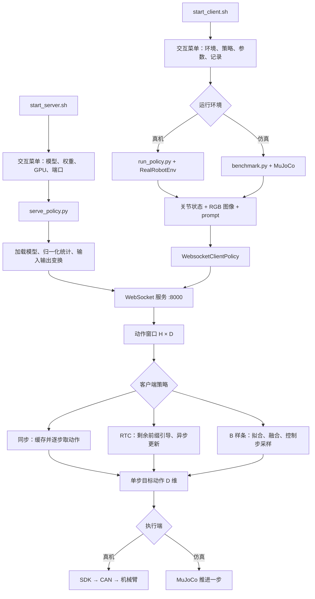

# 真机与仿真推理：服务器、客户端及 B 样条完整链路

启动菜单默认参数现由 [scripts/inference_python/configs](../scripts/inference_python/configs/README.md) 管理：
`server.yaml` 控制服务器，`client.yaml` 控制客户端，使用 common + sim/real profiles 分层。
可通过 `--config /path/to/client.yaml` 指定客户端配置，`--target real` 直接进入真机模式。
切换环境会重置菜单值为对应 YAML 默认值；原始文件不覆盖，启动时保存 launcher 参数快照。


更新日期：2026-11-27。本文描述当前仓库实现，不代表已通过物理机械臂验证。

## 0. 安装环境

使用 **uv sync**，服务端、仿真客户端、真机客户端分别安装到独立目录。
**只需首次部署或依赖变更时安装，日常推理直接运行启动命令。**

前提：uv 已可用；GPU 机器驱动正常；真机已准备 CAN/USB 驱动和匹配 URDF。
所有命令在项目根目录执行：

```bash
cd /root/workspace/bspline_test/openpi
```

### 0.1 服务端

安装模型推理和交互终端依赖，环境目录 `.venv-server`：

```bash
GIT_LFS_SKIP_SMUDGE=1 UV_LINK_MODE=copy UV_PROJECT_ENVIRONMENT=.venv-server \
  uv sync --python 3.11 --locked --no-default-groups --group inference-server
```

日常启动，在菜单选择真机或仿真模型及对应权重：

```bash
source .venv-server/bin/activate
bash scripts/start_server.sh
```

### 0.2 仿真客户端

安装 MuJoCo、客户端和插件，环境目录 `.venv-sim`；不安装服务端模型依赖：

```bash
GIT_LFS_SKIP_SMUDGE=1 UV_LINK_MODE=copy UV_PROJECT_ENVIRONMENT=.venv-sim \
  uv sync --python 3.11 --locked --only-group inference-sim
```

日常启动，在另一个终端运行：

```bash
source .venv-sim/bin/activate
bash scripts/start_client.sh --target sim
```

选择 EGL 渲染时，机器需要可用的 GPU/EGL 环境。

### 0.3 真机客户端

安装真机公共依赖和 V4L2 相机接口，环境目录 `.venv-real`：

```bash
GIT_LFS_SKIP_SMUDGE=1 UV_LINK_MODE=copy UV_PROJECT_ENVIRONMENT=.venv-real \
  uv sync --python 3.11 --locked --only-group inference-real --only-group inference-v4l2
```

**实际连接机械臂还需要厂商 Y1 SDK。** 在根 `pyproject.toml` 中：

1. 在已有 `inference-real` 依赖列表中启用 `"y1-sdk"`。
2. 在已有 `[tool.uv.sources]` 中填写实际 SDK 安装目录：

```toml
y1-sdk = { path = "/实际路径/y1_sdk_python/y1_sdk", editable = true }
```


```
找到根 pyproject.toml 中已有的这一组，加入 "y1-sdk"：
[dependency-groups]
inference-real = [
    { include-group = "inference-client" },
    "opencv-python==4.11.0.86",
    "rerun-sdk==0.23.1",
    "y1-sdk",
]

假设厂商给你的 SDK 放在：
/root/workspace/y1_sdk_python/
└── y1_sdk/
    ├── pyproject.toml 或 setup.py
    └── SDK 源码文件
那么在已有的 [tool.uv.sources] 中加入：
[tool.uv.sources]
# 保留这里其他已有配置
y1-sdk = {
    path = "/root/workspace/y1_sdk_python/y1_sdk",
    editable = true,
}
实际文件中也可以写成一行：
y1-sdk = { path = "/root/workspace/y1_sdk_python/y1_sdk", editable = true }
```

修改依赖后，首次同步不带 `--locked`，让 uv 更新锁文件：

```bash
GIT_LFS_SKIP_SMUDGE=1 UV_LINK_MODE=copy UV_PROJECT_ENVIRONMENT=.venv-real \
  uv sync --python 3.11 --only-group inference-real --only-group inference-v4l2
```

如果用 **Orbbec 相机**，在 pyproject.toml 中启用以下预留条目：

```toml
# 放入已有 [dependency-groups]
inference-orbbec = ["pyorbbecsdk"]

# 放入已有 [tool.uv.sources]，替换为匹配 Python 3.11 和设备的真实 wheel 路径
pyorbbecsdk = { path = "/实际路径/实际Orbbec文件名.whl" }
```

然后用对应相机组同步：

```bash
GIT_LFS_SKIP_SMUDGE=1 UV_LINK_MODE=copy UV_PROJECT_ENVIRONMENT=.venv-real \
  uv sync --python 3.11 --only-group inference-real --only-group inference-orbbec
```

依赖与锁文件一致后可加回 `--locked`。同时使用两种相机时，保留两个相机组。
Y1 SDK 和 Orbbec SDK 未随仓库提供，必须先取得匹配的厂商包。

日常启动：

```bash
source .venv-real/bin/activate
bash scripts/start_client.sh --target real
```

在 [y1_hardware.yaml](../scripts/inference_python/configs/y1_hardware.yaml) 中配置 CAN 和相机映射，
并准备 `scripts/inference_python/assets/imeta_y1/y1_with_gripper.urdf` 及其关联资源。
服务器在其他机器时，客户端填写服务器 IP，不能填写 localhost。
实际单臂模型输出适配限制见第 19 节。

### 0.4 B 样条、记录与绘图插件

**上面的仿真和真机客户端命令已自动安装，无需额外安装命令：**

| 包 | 用途 |
| --- | --- |
| openpi-client | 连接模型服务器 |
| openpi-async_bspline[plot] | 异步 B 样条、内部诊断绘图 |
| openpi-trajectory-recorder[plot] | 内存记录、结束后曲线分析 |

依赖由根 pyproject.toml 的 `inference-client` 组管理，两个客户端组都会包含它。
B 样条与记录插件按本地 editable 源码安装；服务器不需要安装这两个插件。
只修改外部 YAML 参数，不需要重新 uv sync 或打包，重新加载配置并重启客户端即可。

### 0.5 使用说明

- 三个环境互相独立；启动前用 `source .venv-server/bin/activate`、`source .venv-sim/bin/activate` 或 `source .venv-real/bin/activate` 激活对应环境。
- `--locked` 保证依赖与锁文件一致；修改 pyproject.toml 后首次 uv sync 去掉该参数。
- 客户端保留 `--only-group`，避免安装 JAX、Torch 等服务端依赖。
- uv sync 只安装所选依赖；不要对客户端环境执行未指定分组的 uv sync。
- 系统驱动、CAN 接口、相机权限、URDF 和模型权重不由 uv sync 安装。

只检查交互配置、不启动模型或硬件时，在启动命令末尾加 `--dry-run`。


## 1. 启动方式与职责

完成第 0 节安装后，打开两个终端。每个终端先进入项目根目录，再指定对应的 Python 环境。

**终端 1：服务端（真机与仿真共用服务端环境）**

```bash
cd /root/workspace/bspline_test/openpi
source .venv-server/bin/activate
bash scripts/start_server.sh
```

**终端 2：仿真客户端**

```bash
cd /root/workspace/bspline_test/openpi
source .venv-sim/bin/activate
bash scripts/start_client.sh --target sim
```

**如果运行真机，终端 2 改用以下命令，不需要再启动仿真客户端：**

```bash
cd /root/workspace/bspline_test/openpi
source .venv-real/bin/activate
bash scripts/start_client.sh --target real
```

激活在当前终端持续有效，后续可直接重复执行启动脚本；新开终端需要重新激活。
`--target` 选择运行配置，不负责切换 Python 环境；切换真机/仿真时先退出客户端，
执行 `deactivate`，再 `source .venv-real/bin/activate` 或 `source .venv-sim/bin/activate`，
用匹配的 `--target` 重新启动。日常启动无需重新执行 `uv sync`。

服务器加载模型，客户端获取观测、请求推理、处理轨迹并执行动作。
**B 样条优化在客户端，不在模型服务器或机械臂驱动中。**



- `H`：一次模型返回的动作步数，默认 50。
- `D`：双臂 14 维；单臂客户端要求 7 维，实际单臂服务端适配问题见第 19 节。
- 模型请求频率、客户端控制频率、相机采集频率是不同概念。

## 2. Shell 启动脚本与 Python 环境

入口：[start_server.sh](../scripts/start_server.sh)、[start_client.sh](../scripts/start_client.sh)。

两个脚本根据自身位置定位项目根目录，检查 Python 是否可执行，然后使用 `exec` 运行
[launcher.py](../scripts/interactive/launcher.py)，分别传入 `server` / `client`。

脚本默认使用已激活虚拟环境中的 `$VIRTUAL_ENV/bin/python`；未激活时会提示并退出。
服务端激活 `.venv-server`，仿真客户端激活 `.venv-sim`，真机客户端激活 `.venv-real`。
交互菜单及后续推理进程使用同一个 Python。

兼容显式覆盖：`OPENPI_SERVER_PYTHON` / `OPENPI_CLIENT_PYTHON` 若已设置，会优先于激活环境。
如果以前设置过它们，改用激活方式前执行一次：

```bash
unset OPENPI_SERVER_PYTHON OPENPI_CLIENT_PYTHON
```

`exec` 替换当前进程，不会自动后台运行。服务端与客户端各占用一个终端，可以位于不同机器。
菜单切换真机/仿真不会自动切换 Python 环境。

正常 TTY 使用 questionary 方向键菜单：上下移动、Enter 确认、Space 多选、Ctrl+C 取消。
`--plain` 或管道输入使用编号菜单。`--dry-run` 只显示命令，不启动模型或硬件；
B 样条客户端仍会保存本次配置快照。

## 3. 服务端菜单与环境切换

| 设置 | 仿真 | 真机 |
| --- | --- | --- |
| 模型配置 | `pi0_aloha_sim_rtc` | `pi05_rtc_inference_dual_arm` |
| 默认权重 | `checkpoints/pi0_aloha_sim` | `checkpoints/pi05_base_full_dual_arm/bi_y1_test_20260410/30000` |
| 用途 | ALOHA 方块移交 | 原有 Y1 双臂任务 |

切换环境只是更换模型预设，不会将仿真权重转换为真机权重，也不保证默认权重路径存在。
选择“启动服务端”时检查端口、显存比例、本地 checkpoint 目录和配置名是否为空。
`gs://` 权重地址交给后续加载器处理。

设置以下环境变量后启动模型进程：

- `CUDA_VISIBLE_DEVICES`：选择可见 GPU。
- `PYTHONPATH`：加入项目 `src`。
- `OPENPI_DATA_HOME`：模型相关缓存目录。
- `XLA_PYTHON_CLIENT_MEM_FRACTION`：JAX 显存预分配比例。

生成命令形如：

```bash
python scripts/serve_policy.py --port 8000 \
  policy:checkpoint --policy.config 模型配置名 --policy.dir 权重路径
```

没有单独的“B 样条模型服务”。兼容的 RTC 服务器可以服务三种客户端策略；是否启用 RTC
由请求中的 `enable_rtc` 决定。

## 4. 模型加载与服务器监听

[serve_policy.py](../scripts/serve_policy.py) 根据配置名取得
[TrainConfig](../src/openpi/training/config.py)，调用
[create_trained_policy](../src/openpi/policies/policy_config.py)。

加载顺序：

1. 解析本地或远程 checkpoint。
2. 根据配置创建模型结构。
3. 若 checkpoint 有 `model.safetensors`，走 PyTorch 分支；否则从 `params` 加载 JAX 参数。
4. 从 checkpoint 的 `assets` 读取归一化统计。
5. 创建输入变换、模型采样、输出变换组成的 Policy。
6. 创建 WebSocket 服务，监听 `0.0.0.0:8000`（端口可修改）。

配置与权重必须匹配：模型版本、动作定义、归一化统计、关节/夹爪变换都属于匹配内容。
不能仅凭“都是 14 维”判断权重可以互换。

同机客户端连接 `localhost`，跨机器连接服务器实际 IP；`0.0.0.0` 是监听地址。
模型加载完成并开始监听不代表所有输入形状的首次 JIT 编译已经完成。

## 5. 客户端菜单与配置流转

| 内容 | 仿真 | 真机 |
| --- | --- | --- |
| 实际程序 | `examples/aloha_sim/benchmark.py` | `scripts/inference_python/run_policy.py` |
| 默认样条 YAML | `aloha_sim.yaml` | `y1_real.yaml` |
| 控制频率 | 固定 50 Hz | 默认 30 Hz |
| 默认重规划间隔 | 15 步 | 8 步 |
| 执行环境 | MuJoCo | Y1 SDK / CAN |
| 任务组织 | 多回合、种子、奖励 | 一次有限步数任务 |

切换环境会重新载入样条默认值、频率、间隔和输出目录，建议先选环境再编辑参数。
客户端可选择策略、服务器地址、任务提示词、单/双臂、相机接口、设备 YAML、记录和录像等。
真机菜单不展示无效的仿真回合/种子选项。

B 样条配置流程：

```text
原始 YAML → 菜单内存配置 → 输出目录/bspline_config_时间戳.yaml
                                ↓ --bspline-config
                           实际推理进程
```

原模板不覆盖；运行期间不会热重载。B 样条模式使用 YAML 的 `replan_interval`，
同步/RTC 使用客户端菜单的 `interval`。

设备配置是另一层：[y1_hardware.yaml](../scripts/inference_python/configs/y1_hardware.yaml)
负责 CAN、V4L2 设备路径、Orbbec 序列号；
[y1_real.yaml](../packages/openpi-async_bspline/configs/y1_real.yaml) 负责样条和调度。

## 6. 真机客户端初始化顺序

入口：[run_policy.py](../scripts/inference_python/run_policy.py)。

1. 解析命令行，检查频率、步数、间隔等。
2. 根据单/双臂确定动作维数为 7/14。
3. B 样条模式读取 YAML，检查 `fps == hz`、`interval + offset < horizon - 1`、旁路索引范围。
4. 检查输出模式目录尚不存在。
5. 读取硬件 YAML。
6. 创建 WebSocket 客户端，接收服务器元数据。
7. 验证 `robot=y1`、动作维数、窗口长度；RTC 还验证 `rtc=True` 和 `rtc_prefix_space=environment`。
8. 导入硬件环境，注入 CAN 和相机映射，创建环境对象。
9. 如开启记录，预分配 recorder；创建策略对象。
10. 创建输出目录，写入 `config.json`。
11. 调用 `env.set_up()`，开始初始化物理设备。

元数据是配置声明，不是自动检验 checkpoint 训练语义的机制。
`--mock` 使用模拟状态、黑图像和保持位置模型，不连接服务器，不导入硬件驱动。

## 7. 机械臂与相机初始化

环境：[real_robot_env.py](../scripts/inference_python/real_robot_env.py)。
驱动：[imeta_y1.py](../scripts/inference_python/robot/imeta_y1.py)。

`set_up()` 先初始化机械臂，再启动相机：

```text
CAN 接口 + URDF
    ↓
Y1SDKInterface(enable_arm=True)
    ↓ Init()
NRT_JOINT_POSITION 控制模式
```

默认左臂 `can0`，右臂 `can1`，单臂只使用右臂。初始化会使能机械臂。
SDK 引用 `scripts/inference_python/assets/imeta_y1/y1_with_gripper.urdf`，需提供匹配资源。

统一入口不会从数据集读取初始姿态并移动过去，也没有旧脚本的额外 Enter 确认步骤。
初始化后尝试等待完整观测，设置了 5 秒检查期限；由于底层相机读取可能阻塞，
这不是严格的 5 秒硬超时。

## 8. 不使用 ROS 时的图像获取

| 接口 | 定位方式 | 采集方式 |
| --- | --- | --- |
| V4L2 | `/dev/cam_high` 等设备路径 | mmap 获取 MJPEG，后台线程解码并转换 RGB |
| Orbbec | 相机序列号 | pyorbbecsdk 彩色流回调缓存最新帧 |

代码：[v4l2_camera.py](../scripts/inference_python/camera/v4l2_camera.py)、
[orbbec_camera.py](../scripts/inference_python/camera/orbbec_camera.py)。

V4L2 默认请求 640×480 MJPEG，清理积压帧后解码最新帧，使用锁保护缓存。
它没有在当前实现中显式配置采集帧率，不能将控制频率当成相机采集频率。
Orbbec 请求 640×480 RGB 30 FPS；只启用彩色流，没有深度图。
Orbbec 的 `get_image(timeout=...)` 当前未实际使用 timeout，无缓存时立即返回 None。

环境优先读取缓存，失败时再调用默认等待取图。图像由 HWC 转为 CHW：

```python
images[cam_name] = np.transpose(image, (2, 0, 1))
```

各相机独立取最新帧，没有严格多相机或关节时间同步；缓存存在不代表图像新鲜，
没有强制帧龄检查。所选相机驱动按需导入，不要求同时安装 V4L2 和 Orbbec。

## 9. 观测结构与动作顺序

SDK 的 `GetJointPosition()` 提供每臂六个关节位置和一个夹爪值。
双臂状态按左臂在前、右臂在后拼接：

```text
[左关节0～5, 左夹爪, 右关节0～5, 右夹爪]
   0～5        6       7～12        13
```

主循环获取观测并加上提示词：

```python
{
    "state": ...,  # 双臂 (14,)，单臂客户端 (7,)
    "images": {
        "cam_high": ...,        # RGB，(3,H,W)
        "cam_left_wrist": ...,
        "cam_right_wrist": ...,
    },
    "prompt": "任务描述",
}
```

服务端 AlohaInputs 要求基础相机 `cam_high`；腕部图像映射为模型内部名称，
缺少腕部图像时可用黑图和 image_mask 表示，但实际部署仍应遵循训练相机配置。
关节单位、夹爪量程不能靠数组形状确定，需与 SDK 和训练数据匹配。

## 10. WebSocket 请求与服务端推理

[客户端](../packages/openpi-client/src/openpi_client/websocket_client_policy.py)
连接时先接收并保存 metadata。连接被拒绝时每 5 秒重试；这不是对所有网络错误的通用重连。

每次 `infer()`：

```text
观测字典 → msgpack_numpy → WebSocket 二进制消息
    → 服务端反序列化 → Policy.infer()
    → 动作与计时结果序列化 → 客户端反序列化
```

图像放在每次观测请求中，不走 ROS topic，也没有独立视频流。WebSocket 显式关闭压缩。
客户端 `infer()` 是阻塞调用，RTC/B 样条依靠工作线程实现异步。

[Policy](../src/openpi/policies/policy.py) 与
[构造器](../src/openpi/policies/policy_config.py) 负责：

1. 观测复制、相机映射、状态坐标适配。
2. 使用 checkpoint 统计归一化，进行图像/提示词处理与维度适配。
3. 添加 batch 维度，调用模型动作采样。
4. 反归一化、按配置恢复绝对关节目标、输出坐标转换。
5. 返回 `actions` 窗口。

有环境空间 RTC 前缀时，它经过相应动作变换和归一化再用于模型引导。
是否启用增量动作和 ALOHA 坐标适配，由训练配置决定。

[服务器](../src/openpi/serving/websocket_policy_server.py) 附加 `server_timing.infer_ms`，
后续可能附加 `prev_total_ms`。后者计时包含等待接收请求，不能解释为纯模型推理耗时。
服务器异常时发送文本 traceback 并关闭连接，客户端收到文本会抛出 RuntimeError。
客户端 `reset()` 当前是空实现，不会重置服务器 RNG 或重新加载模型。

## 11. 同步模式

[SyncPolicy](../examples/aloha_sim/benchmark_policies.py) 第一次阻塞请求动作窗口，
随后逐步读取缓存。真机默认 interval=8：执行窗口第 0～7 步，再获取最新观测重新推理。
模型虽然返回 50 步，但通常只使用前 8 步就替换窗口。

没有后台推理、B 样条或旧脚本的 10 点线性插值。等待服务器时不下发新目标，
驱动仍可能继续执行上一个目标。

## 12. RTC 模式

[RTCPolicy](../examples/aloha_sim/benchmark_policies.py) 只允许一个工作线程和一个在途请求。

1. 首次没有缓存，等待模型返回。
2. 主线程执行旧窗口，达到间隔后向后台提交观测。
3. 发送观测时刻尚未执行的旧动作前缀。
4. 推理期间继续执行旧动作。
5. 新窗口返回后，按已经推进的逻辑控制步跳过过期部分。

请求包含：

```python
{
    "enable_rtc": True,
    "prev_action_chunk": ...,
    "rtc_prefix_space": "environment",
    "inference_delay": ...,
    "execute_horizon": ...,
    "max_guidance_weight": ...,
}
```

前缀补齐成固定形状以减少重编译，有效执行范围限定真正可用的前缀。
延迟按最近请求耗时 × 控制频率估计。轨迹耗尽或响应完全过期则报错，
不会无限重复末尾动作。

新入口没有调用旧 `y1_openpi_inference_rtc.py`，没有沿用其 temporal 混合、
300 Hz 线性插值和自动重连逻辑。

## 13. B 样条模式的线程与时间轴

核心：[policy.py](../packages/openpi-async_bspline/src/openpi_async_bspline/policy.py)、
[trajectory.py](../packages/openpi-async_bspline/src/openpi_async_bspline/trajectory.py)、
[融合算法](../packages/openpi-async_bspline/src/openpi_async_bspline/bspline_c2_merge.py)。

```text
主线程：AsyncBSplinePolicy.infer()
  ├─ 检查后台结果 → 从已准备的位置数组取当前动作
  └─ 达到间隔且无在途请求 → 提交工作线程
                              ↓
               ModelAdapter → WebSocket → 模型
                              ↓
                    动作校验 → 拟合与融合
                              ↓
                     准备控制步采样数组
```

ModelAdapter 在此模式设置 `enable_rtc=False`；这是模型输出后做样条优化，
不是 RTC 与 B 样条叠加。它检查模型输出必须严格等于 `(horizon, dimension)` 且全为有限值。

首窗没有旧轨迹，需要阻塞等待模型和拟合。后续窗口后台计算，主线程只取数组；
提交请求时仍会深拷贝观测（含图像），并非完全零开销。

### 拼接点

设新请求在逻辑步 s 提交，模型返回时执行到 k，offset=3：

```text
新动作窗口时间轴起点 = s
anchor = k + 3
```

例如第 8 步提交、第 12 步返回，则 anchor=15。融合结果在 t≤15 保留旧的规划前缀，
t>15 使用融合新轨迹，并施加拼接点位置必经约束。

offset 是模型返回后的拼接预留步数，不是固定网络延迟补偿。
工作线程完成后若当前步已越过 anchor，会报拼接超时；轨迹耗尽也会报错。

### 参数与实际算法

| 参数 | 行为 |
| --- | --- |
| degree | 样条次数 |
| knots_interior | 当前动作窗口拟合的内部节点数 |
| merge_input_mode=crop | 裁剪已有拟合曲线参与融合 |
| merge_input_mode=refit | 分段后重新拟合 |
| knots_interior_merge | refit 旧段拟合节点数 |
| max_deriv | 融合内部导数约束阶数 |
| interpolate_factor | 后台均匀插值缓存密度；0 表示直接求值 |
| passthrough_indices | 夹爪等绕过平滑的维度 |

样条按控制步计时，后台生成每个整数控制步的位置数组。
启用速度/加速度时计算导数并按 fps / fps² 换算；旁路维度采用有限差分。

**C2 名称不意味着旧执行轨迹到新轨迹切换时速度、加速度都严格连续。**
当前必经点机制明确匹配的是位置，不能作更强的连续性保证。

## 14. 动作到 SDK 的映射

三种策略最终统一调用 `env.step(result["actions"])`。
双臂按以下顺序发送：

```python
left.set_joint_position(action[0:6])
left.set_gripper(action[6])
right.set_joint_position(action[7:13])
right.set_gripper(action[13])
```

底层分别调用 `SetArmJointPosition` 和 `SetGripperStroke`。

- 下发关节位置和夹爪开度，不是末端位姿。
- 左右臂调用依次进行，不是硬件原子同步命令。
- SDK 的速度参数目前默认固定为 3，其含义以驱动定义为准。
- 样条 `velocities` / `accelerations` 没有送入 SDK 控制，执行端只取 `actions`。
- 新入口不再叠加额外线性插值。

## 15. 控制频率与逻辑步

真机主循环：

```python
began = time.perf_counter()
# 采集观测 → 策略 → 校验 → SDK 下发 → 内存记录 → 复制录像帧
sleep(max(0, 1 / hz - 已用时间))
```

30 Hz 名义周期约 33.3 ms。工作耗时 10 ms 时休眠约 23.3 ms；耗时 45 ms 时不休眠。
这是尽力维持频率，不是硬实时调度，没有超时补发追赶机制。

RTC/B 样条每次 infer 推进一个逻辑步。循环变慢时，轨迹墙钟执行时间拉长。
YAML fps 用于时间/导数换算，不会强制驱动达到该频率。
30 Hz、间隔 8 步时请求频率名义约 3.75 Hz；后台没完成则不会继续堆叠请求。

## 16. 内存记录、绘图、录像与输出

执行前预分配最多 steps 条轨迹，写入配置；执行中只记录数组和可选视频帧，
执行结束后才压缩、绘图和视频编码。

```text
OUTPUT/MODE/
├── config.json
├── summary.json
├── trajectory.npz
├── plots/
│   ├── curves.pdf
│   ├── *.png
│   └── 指标文件
├── camera.mp4
└── bspline_diagnostics/
```

记录/绘图/录像/内部诊断按各自开关启用。
轨迹记录包括下发目标、下发前的反馈状态、时间戳和计时，不是驱动执行完成回执。
真机入口中的 `infer_seconds` 当前从采集观测前开始计时，包含采集和策略调用，
不能当作模型 RPC 耗时。

执行记录的速度和加速度按名义 hz 有限差分，不等同于样条解析导数或传感器直接测量。
视频保存第一路配置相机，默认 cam_high，每控制步复制一帧并按名义 hz 编码，可能重复帧。
视频内存受 steps 限制，但高分辨率长时录制仍有明显内存及复制开销，不是零性能影响。

独立 recorder 与样条内部诊断不同：前者记录三种策略实际下发动作，后者观察拟合/融合阶段。
样条诊断有容量上限，超出丢弃新记录并计数，不在控制循环内绘图。

## 17. 退出与异常处理

达到 steps、Ctrl+C 或异常后，真机进入 finally：

```text
env.stop() → policy.close() → summary
           → 轨迹保存/分析 → 视频编码 → 样条诊断
```

- env.stop 停相机及可视化线程，当前不调用电机失能或硬件急停。
- RTC/B 样条 close 等待正在运行的线程，不能强制取消运行中的 Python 网络请求。
- WebSocket recv 没有应用层推理截止时间，服务器不返回可能拖住线程等待和退出。
- 新统一入口没有旧 RTC 脚本的自动重连。
- 保存顺序执行，清理或某个保存阶段出错会影响后续文件生成；并非所有异常下都保证完整输出。

启动前验证失败通常尚未使能机械臂；进入 set_up 后的失败需要区分已初始化的设备。

## 18. 仿真分支差异

[benchmark.py](../examples/aloha_sim/benchmark.py) 创建 MuJoCo 环境，检查仿真元数据，
执行两次模型预热（RTC 含前缀请求），然后按 seed 运行多个 episode。
回合结束计算奖励、成功率、耗时、动作指标并保存；最后关闭策略和环境。

真机新入口不读取数据集、不自动回初始位姿、没有独立模型预热、没有奖励或成功判定，
仅按有限步数执行。首次模型请求可能包含编译开销。

仿真阻塞推理时物理环境不推进，真机则可能继续执行上一个目标。
所以仿真成功率和超时表现不能直接等同于真机控制效果。

## 19. 当前未解决问题与验证边界

### 单臂模型输出适配尚未完成

客户端严格要求 `(H,7)`，但公共
[AlohaOutputs](../src/openpi/policies/aloha_policy.py) 仍截取前 14 维。
单臂 mock 通过证明的是客户端调度支持 7 维，不证明实际服务端返回 7 维。
`action_dim=7` 元数据不能改变输出变换。此前“单臂可直接使用”的表述应以此更正。

### 训练坐标与控制语义需要匹配

默认真机 RTC 配置继承 LeRobotAlohaDataConfig 的坐标适配和增量动作默认值，
必须与 checkpoint 训练方式一致。形状与有限值检查不能验证关节单位、夹爪量程或坐标约定。

### 当前控制层的范围

没有新增关节限位、最大单步变化、碰撞检查、严格帧龄检测或电机急停/失能。
当前真机接口是 Y1 SDK，不能仅凭机械臂商品名称断言兼容。

截至本次实现检查，开发环境缺少 Y1 SDK、相机驱动、匹配 URDF 和真机权重。
完成的是 mock、调度器与启动器测试，以及 NPZ/PDF/视频输出检查，尚无物理机械臂闭环验证。

## 20. 相关入口与无硬件检查

- [真机部署简明说明](../scripts/inference_python/REAL_ROBOT.md)
- [仿真对比说明](../examples/aloha_sim/BENCHMARK.md)
- [B 样条插件说明](../packages/openpi-async_bspline/README.md)
- [独立轨迹记录插件](../packages/openpi-trajectory-recorder/README.md)

```bash
# 只预览交互配置，不初始化设备
source .venv-server/bin/activate
bash scripts/start_server.sh --dry-run
source .venv-real/bin/activate
bash scripts/start_client.sh --target real --dry-run

# 同一真机控制入口，但以模拟设备/模型验证
.venv-real/bin/python scripts/inference_python/run_policy.py \
  --mode bspline --mock --steps 60 --prompt test \
  --record-trajectories --plot-trajectories \
  --output /tmp/y1_bspline_smoke
```

将 mode 改成 sync / rtc 可检查另外两种模式。输出会标记 mock，不应解读为真机任务成绩。
